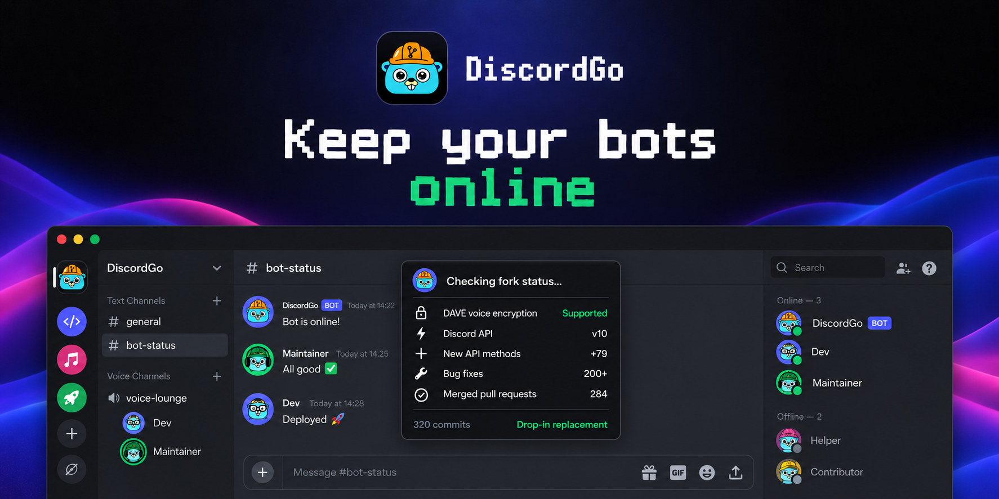

<p align="center">
  
</p>

# DiscordGo (maintained fork)

A maintained fork of [bwmarrin/discordgo](https://github.com/bwmarrin/discordgo),
the [Go](https://go.dev/) bindings for the [Discord](https://discord.com/) API.

Upstream's last change was in February 2026 and its last release was v0.29.0
(May 2025). Discord has shipped a lot since then, including mandatory DAVE
encryption for voice. This fork tracks those changes, keeps the same import
path and API, and switching takes one `replace` line.

Not affiliated with or endorsed by the original DiscordGo authors.

## Up to date with Discord

Every Discord API change from 2026 is checked against this library. Last
checked: **October 31, 2026**.

| Date | Discord change | Status |
|---|---|---|
| Oct 30 | [Member and role permission endpoints](https://docs.discord.com/developers/change-log#new-endpoints-for-getting-member-and-role-permissions-for-guilds-and-channels) | ✅ `GuildMemberPermissions`, `GuildRolePermissions`, `ChannelMemberPermissions`, `ChannelRolePermissions` |
| Oct 29 | Voice channel status works without `CONNECT` | ✅ Documented on `ChannelVoiceStatusSet` |
| Oct 29 | Channel and role position audit log events | ✅ `AuditLogActionChannelPositionUpdate`, `AuditLogActionRolePositionUpdate` |
| Oct 28 | Content scanning flags on attachments, embeds and media | ✅ `Contains*Content` flags, `ContentScanMetadata` |
| Oct 14 | OAuth2 redirects include `iss` | Nothing to add. Your redirect handler checks it |
| Oct 5 | Component embeds in link previews | ✅ `EmbedTypeComponents`, `MessageEmbed.Components` |
| Sep 22 | Age assurance rollout | Nothing to add. Runtime behavior only |
| Sep 18 | Invite target user endpoints | ✅ `InviteTargetUserAdd`, `InviteTargetUserRemove`, bulk add and delete, `Invite.TargetUserIDs` |
| Sep 17 | Custom status hidden by profile privacy | ✅ Documented on `ActivityTypeCustom` |
| Sep 15 | `shard` required for Get Current User Guilds with large bot sharding | ✅ `UserGuildsOptions.Shard` |
| Sep 3 | Default upload limit raised to 20 MiB | Nothing to add. Enforced by Discord |
| Aug 27 | `PRUNE_REQUIRES_ADMIN` guild feature | ✅ `GuildFeaturePruneRequiresAdmin` |
| Aug 26 | Game stats widgets | ✅ `ApplicationIdentityProfile`, `ApplicationIdentityProfileUpdate` |
| Aug 14 | Battle.net connections removed from user connections | Nothing to add |
| Aug 12 | Channel obfuscation | ✅ `ChannelFlagObfuscated`, `GatewayCapabilityChannelObfuscation` |
| Aug 5 | File type filters for uploads and attachment options | ✅ `FileTypes` on file upload components and command options |
| Aug 5 | Channel `application_id` can be `null` | Nothing to add. Decodes cleanly |
| Jul 16 | `app_permissions` on resolved interaction channels | ✅ `Channel.AppPermissions` |
| Jun 24 | Attachment editing and `is_spoiler` | ✅ `MessageAttachment.IsSpoiler`, `MessageAttachmentFlagsIsSpoiler` |
| Jun 16 | Subscription status values corrected | ✅ `SubscriptionStatusInactive` = 1, `SubscriptionStatusEnding` = 2 |
| Jun 10 | Privileged intent policy changes | Nothing to add. Policy only |
| Jun 3 | Lobby HTTP endpoints | ✅ 16 `Lobby*` methods |
| May 7 | `flags_new` on applications | ✅ `Application.FlagsNew` |
| May 5 | `premium_type` needs a scope | Nothing to add |
| Apr 20 | Voice channel status and start time | ✅ `ChannelVoiceStatusSet`, `RequestChannelInfo`, status and start time events |
| Apr 14 | Forwarding requires message content access | ✅ `ErrCodeCannotForwardAMessageWhoseContentYouCannotRead` |
| Mar 19 | Search guild messages | ✅ `GuildMessagesSearch`, `SearchIndexNotReadyError` |
| Mar 3 | Context menu command limit raised to 15 | Nothing to add |
| Feb 20 | Server-side message moderation | ✅ `LobbyMessageModerationMetadataUpdate`, `GameDirectMessageModerationMetadataUpdate` |
| Feb 12 | Radio groups, checkbox groups and checkboxes in modals | ✅ `RadioGroupComponent`, `CheckboxGroupComponent`, `CheckboxComponent` |
| Feb 5 | Community invites update | ✅ Partial roles decode into `Role`, target users CSV |
| Jan 13 | Invites that grant roles or target users | ✅ `Invite.RoleIDs`, `InviteTargetUsers`, `InviteTargetUsersUpdate`, `InviteTargetUsersJobStatus` |

Client-only entries (Social SDK releases, Embedded App SDK, docs updates) are
left out because they don't touch the HTTP or gateway API. Full list:
[Discord change log](https://docs.discord.com/developers/change-log).

## What upstream is missing

- **DAVE voice encryption.** Required by Discord since March 1, 2026. Upstream
  has none. This fork handles negotiation, Voice Gateway v8, resume,
  participant routing and frame placement. You plug in the MLS and media
  crypto backend (for example a `libdave` binding), so there's no CGO
  dependency. See [docs/DAVE.md](docs/DAVE.md).
- **Discord API v10** by default. Upstream still defaults to v9.
- **Lobbies.** Create, join, edit and delete lobbies, manage members, send
  messages, link channels and moderate messages.
- **Soundboard.** Guild sounds, default sounds, playing sounds in voice, and
  soundboard events and state.
- **Guild management.** Join requests, bulk bans, stickers, welcome screen,
  vanity URL, widget, home settings, incident actions, editing the bot's own
  member, and computed member and role permissions.
- **Search.** Guild message search and thread search.
- **Recurring scheduled events.** Recurrence rules, per-occurrence exceptions
  and user counts.
- **Applications and OAuth2.** Fetch and edit applications, attachments,
  identity profiles, current authorization, OpenID user info, public keys,
  entitlements and role connections.
- **Newer API fields.** Components v2, file upload filters, interaction
  callback responses, super reactions, avatar decorations, nameplates, rich
  presence fields, every documented JSON error code, and the `RATE_LIMITED`
  gateway event.

By the numbers, since the fork started:

- 449 merged pull requests
- 96 new `Session` methods (232 to 328)
- 150 new exported types
- About 41,700 lines of new tests, all run with the race detector

## How reliable is it?

Better than upstream, and not proven perfect.

Several fixes addressed serious crashes, races and cancellation failures,
mostly in the gateway and voice reconnect paths. Many later fixes were small
cache or metadata inconsistencies, so the pull request count overstates how
broken things were.

Every change ships with tests and gets an independent review. That gives real
confidence, but the tests use synthetic payloads. They don't prove behavior
across real Discord reconnects, voice handshakes and outages. Voice and
reconnect lifecycle handling is the most complex part of the library and has
the least live testing behind it.

The focus now is high-impact failures, not a stream of small fixes. If
something breaks in production, please
[open an issue](https://github.com/0x00-sys/discordgo/issues) with logs.

## Install

Requires Go 1.25 or newer.

The module path stays `github.com/bwmarrin/discordgo`, so install with a
`replace` directive and keep your imports as they are:

```sh
go get github.com/bwmarrin/discordgo
go mod edit -replace github.com/bwmarrin/discordgo=github.com/0x00-sys/discordgo@master
go mod tidy
```

`go mod tidy` pins `@master` to the current commit. Run the same commands to
update. `go get github.com/0x00-sys/discordgo` on its own won't work, because
the module declares the upstream path.

`replace` only applies to the main module. If you publish a library that uses
this fork, apps using your library need the same `replace` line.

## Usage

```go
import "github.com/bwmarrin/discordgo"

discord, err := discordgo.New("Bot " + "authentication token")
```

See [examples](examples) for complete programs.

## Switching from upstream

Most bots build without changes. Things to check:

- The default API version is 10, not 9.
- The session reconnects after one missed heartbeat ACK instead of five.
- `IntentsAll`, `IntentsAllWithoutPrivileged` and the `PermissionAll*`
  constants include Discord's newer values. `SubscriptionStatusInactive` and
  `SubscriptionStatusEnding` now match Discord's documented values.
- `GuildScheduledEvent`, `Invite`, `MessageAttachment`, `MessageReactions` and
  `MessageUpdate` gained fields and can no longer be compared with `==`.
- `PollAnswerVoters` and `PollExpire` accept optional `RequestOption`s.
  Existing calls still compile.
- Voice channels that require end-to-end encryption need a
  `VoiceDAVESessionFactory`. Without one, Discord can close the connection with
  code 4017. See [docs/DAVE.md](docs/DAVE.md).

## Documentation

The code is documented inline. pkg.go.dev only shows the upstream module, so
read this fork's docs with `go doc` from a project that uses the `replace`
above, for example `go doc github.com/bwmarrin/discordgo Session`.

- [DAVE voice encryption](docs/DAVE.md)
- [Getting started](docs/GettingStarted.md)
- [Examples](examples)
- Upstream's [Troubleshooting](https://github.com/bwmarrin/discordgo/wiki/Troubleshooting)
  and [Awesome DiscordGo](https://github.com/bwmarrin/discordgo/wiki/Awesome-DiscordGo)
  wiki pages mostly still apply.

## Contributing

Report bugs in [this repository's issues](https://github.com/0x00-sys/discordgo/issues),
not upstream. Contributions are welcome. See [CONTRIBUTING.md](CONTRIBUTING.md).

- Open an issue first so the change can be discussed.
- Match the existing naming conventions.
- The package is a low-level mapping of the Discord API. Discuss anything
  outside that scope before building it.
- Run `gofmt`, `go vet ./...` and `go test -race ./...` before opening a pull
  request against `master`.

## Credits

DiscordGo was created by [Bruce Marriner](https://github.com/bwmarrin) and is
built on years of work by the [upstream contributors](https://github.com/bwmarrin/discordgo/graphs/contributors).
Their full commit history is preserved here.

[Chris Rhodes](https://github.com/iopred) made the original DiscordGo logo and
many pull requests.

The Go gopher was designed by [Renée French](https://reneefrench.blogspot.com/)
and is licensed under [CC BY 4.0](https://creativecommons.org/licenses/by/4.0/).
The mascot in the banner is based on it.

## License

BSD 3-Clause, same as upstream. The original copyright notice, conditions and
disclaimer are unchanged in [LICENSE](LICENSE), and this fork's changes are
distributed under the same terms.
